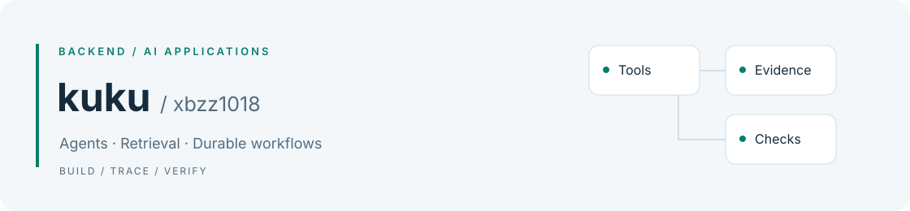

<picture>
  <source media="(prefers-color-scheme: dark)" srcset="assets/banner-dark.svg">
  <source media="(prefers-color-scheme: light)" srcset="assets/banner.svg">
  
</picture>

# Hi, I'm kuku · xbzz1018

I build backend and AI applications.

[中文](README.md) · [Open-source contributions](docs/open-source.md)

## Selected projects

- **[SignalForge](https://github.com/xbzz1018/SignalForge)** — An AI research workspace for Chinese equities, indices, and ETFs. Connects market data, analysis, backtests, generated dashboards, and delivery checks. TypeScript / Next.js / Python / PostgreSQL / Redis.
- **[AgriGraph](https://github.com/xbzz1018/agrigraph)** — Evidence-based agricultural QA using text or image symptoms, Elasticsearch retrieval, Neo4j relationships, and citation checks. An independent implementation using public materials.
- **Engineering document review · private repository** — A personal reproduction of a document review workflow. Retrieval and material Agents gather evidence before a reviewer checks the source documents. Local/Fake business regression and real Temporal development-server recovery tests are recorded; the complete data stack and new strong/light model combination still await validation. Reproduction work is distinguished from historical internship contributions.

## Open source

**12 merged PRs in [bytedance/deer-flow](https://github.com/bytedance/deer-flow), verified November 3, 2026.** Only authored PRs merged into an external upstream are counted.

| Area | Examples |
| --- | --- |
| Model adapters and message integrity | [Codex tool_choice #6898](https://github.com/bytedance/deer-flow/pull/6898), [MiniMax reasoning_content #6071](https://github.com/bytedance/deer-flow/pull/6071), [Claude thinking budget #6060](https://github.com/bytedance/deer-flow/pull/6060) |
| Tool outputs and file references | [Complete artifact URLs #6574](https://github.com/bytedance/deer-flow/pull/6574), [Paths containing spaces #5819](https://github.com/bytedance/deer-flow/pull/5819) |
| Recovery and tracing | [Resumed stream events #5811](https://github.com/bytedance/deer-flow/pull/5811), [Effective model metadata #5902](https://github.com/bytedance/deer-flow/pull/5902) |

[Complete contribution record](docs/open-source.md) · [Live upstream query](https://github.com/bytedance/deer-flow/pulls?q=is%3Apr+author%3Axbzz1018+is%3Amerged)

## More projects

- **[Agent Quality Harness](https://github.com/xbzz1018/agent-quality-gate)** — Frozen datasets, baseline/candidate evaluation, traces, replay, and release gates.
- **[WorkPilot](https://github.com/xbzz1018/workpilot)** — Work-report drafts with Fact/Evidence references and approval before final export.
- **[LearningLoop](https://github.com/xbzz1018/learningloop)** — Study plans, daily tasks, FSRS reviews, typed tools, and recovery records.

## Stack

Python · TypeScript · FastAPI · LangChain / LangGraph · PostgreSQL · Redis · pgvector · Elasticsearch · React / Next.js · Vue · Docker Compose · pytest · GitHub Actions

Each repository documents its setup, validation scope, failure cases, and current limitations.
