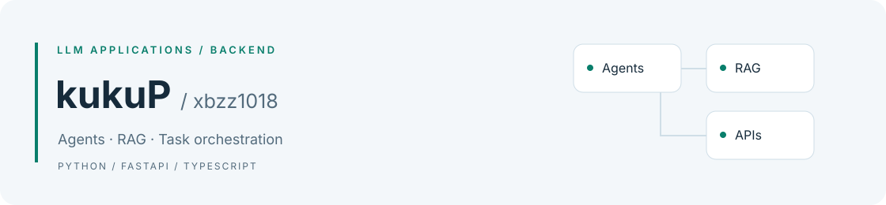
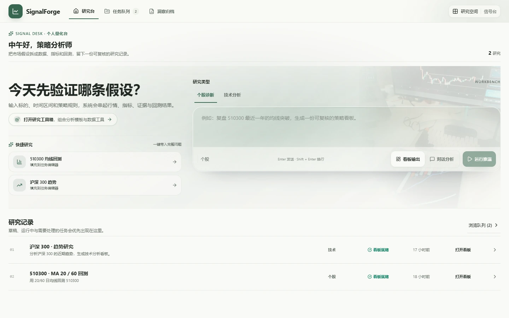
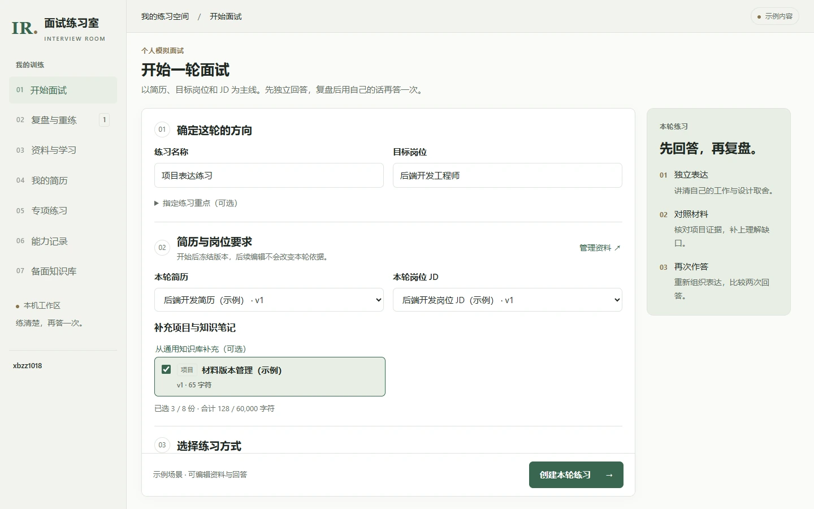
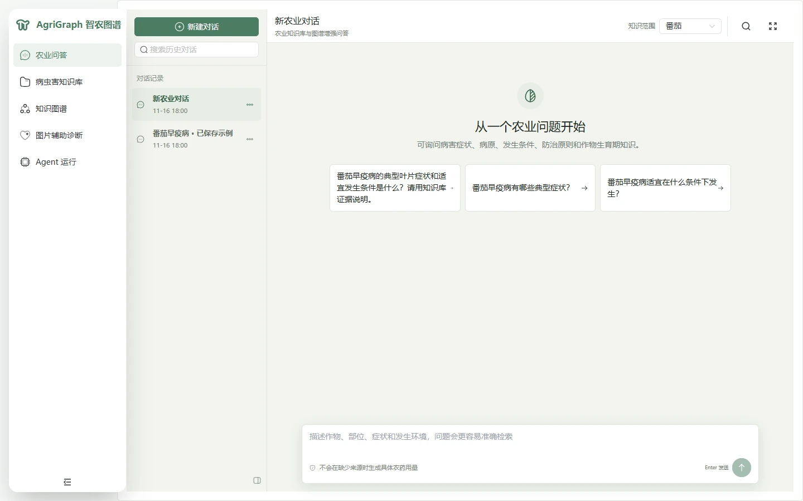
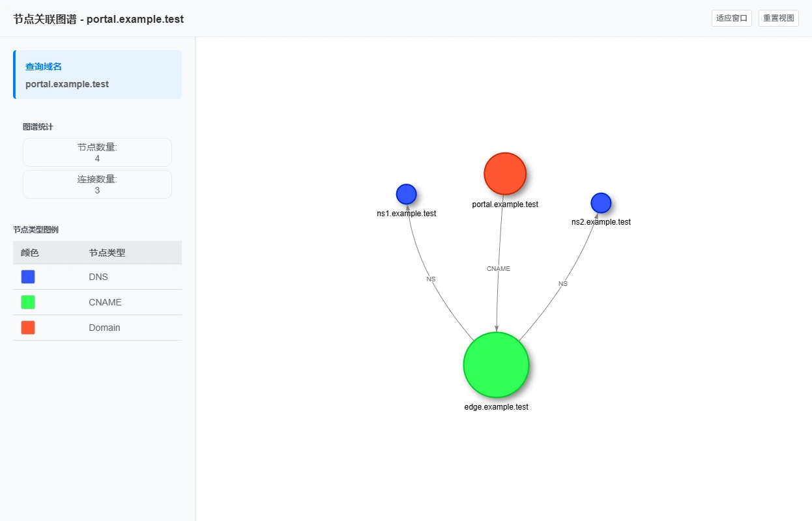

<picture>
  <source media="(max-width: 600px) and (prefers-color-scheme: dark)" srcset="assets/banner-compact-dark.svg">
  <source media="(max-width: 600px)" srcset="assets/banner-compact.svg">
  <source media="(prefers-color-scheme: dark)" srcset="assets/banner-dark.svg">
  <source media="(prefers-color-scheme: light)" srcset="assets/banner.svg">
  
</picture>

I build Agent applications and backend services, with a focus on tool calling, retrieval, and task orchestration.

**[Personal portfolio ↗](https://kukup.xbzz.cloud/)** · [Open-source contributions](#open-source-contributions) · [中文](README.md)

## Selected projects

<table>
  <tr>
    <td width="50%" valign="top">
      <h3>SignalForge</h3>
      <a href="https://kukup.xbzz.cloud/projects/signalforge">
        <picture>
          <source media="(prefers-color-scheme: dark)" srcset="assets/projects/signal-home-dark.webp">
          
        </picture>
      </a>
      
Query market data, backtest strategies, and build interactive dashboards from a research question.

      
<a href="https://kukup.xbzz.cloud/projects/signalforge">Try demo</a> · <a href="https://github.com/xbzz1018/SignalForge-Python">Source</a>

    </td>
    <td width="50%" valign="top">
      <h3>Interview Room</h3>
      <a href="https://kukup.xbzz.cloud/projects/interview-room">
        <picture>
          <source media="(prefers-color-scheme: dark)" srcset="assets/projects/interview-home-dark.webp">
          
        </picture>
      </a>
      
Practice text-based interviews from role and project materials, then review references and retry each answer.

      
<a href="https://kukup.xbzz.cloud/projects/interview-room">Try demo</a> · <a href="https://github.com/xbzz1018/interview-room">Source</a>

    </td>
  </tr>
  <tr>
    <td width="50%" valign="top">
      <h3>AgriGraph</h3>
      <a href="https://kukup.xbzz.cloud/projects/agrigraph">
        <picture>
          <source media="(prefers-color-scheme: dark)" srcset="assets/projects/agrigraph-home-dark.webp">
          
        </picture>
      </a>
      
Investigate crop diseases, follow citations to the source, and explore symptoms and conditions in a graph.

      
<a href="https://kukup.xbzz.cloud/projects/agrigraph">Try demo</a> · <a href="https://github.com/xbzz1018/agrigraph">Source</a>

    </td>
    <td width="50%" valign="top">
      <h3>DomainSystem</h3>
      <a href="https://kukup.xbzz.cloud/projects/domain-system">
        <picture>
          <source media="(prefers-color-scheme: dark)" srcset="assets/projects/domain-graph-dark.webp">
          
        </picture>
      </a>
      
I reproduced an open-source domain management system and added Java APIs for dependency paths and reverse DNS impact analysis.

      
<a href="https://kukup.xbzz.cloud/projects/domain-system">Read the case study</a>

    </td>
  </tr>
</table>

More projects · [Agent Quality Harness](https://kukup.xbzz.cloud/projects/quality-harness) · [SignalForge Java](https://github.com/xbzz1018/SignalForge-Java) · [WorkPilot](https://github.com/xbzz1018/workpilot) · [LearningLoop](https://github.com/xbzz1018/learningloop) · [All public repositories](https://github.com/xbzz1018?tab=repositories&type=source)

## Open-source contributions

| Project | Contributions |
| --- | --- |
| [DeerFlow](https://github.com/bytedance/deer-flow) | Model parameters and tool outputs. [#6898](https://github.com/bytedance/deer-flow/pull/6898) preserves Codex `tool_choice` · [#6574](https://github.com/bytedance/deer-flow/pull/6574) preserves complete artifact URLs (merged) |
| [Cindy](https://github.com/makecindy/cindy) | Add “Show more” for command results beyond the first page. [#4866](https://github.com/makecindy/cindy/pull/4866) (open) |

[Full contribution record](docs/open-source.md) · [View public PRs](https://github.com/search?q=author%3Axbzz1018+is%3Apr+is%3Apublic+-user%3Axbzz1018&amp;type=pullrequests)
