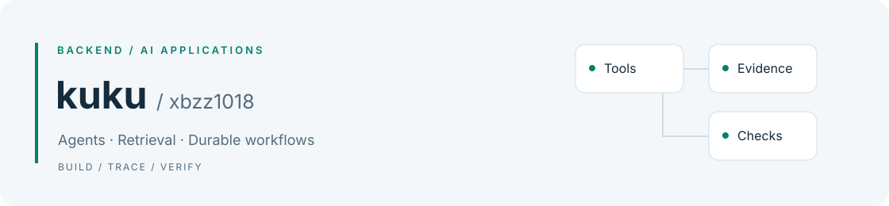

<picture>
  <source media="(prefers-color-scheme: dark)" srcset="assets/banner-dark.svg">
  <source media="(prefers-color-scheme: light)" srcset="assets/banner.svg">
  
</picture>

# Hi, I'm kuku · xbzz1018

后端与大模型应用开发。

[精选项目](#精选项目) · [开源贡献](#开源贡献) · [技术与实践](#技术与实践) · [English](README.en.md)

## 精选项目

### [SignalForge](https://github.com/xbzz1018/SignalForge) · AI 量化研究工作台

用自然语言发起 A 股、指数与 ETF 研究，串联取数、分析、回测和研究看板生成。

- **工程重点**：Agent / Skills 与市场数据服务衔接，后台任务调度、生成工作空间与产物验收。
- **可检查的交付**：页面源码、行情或回测输入、来源记录，以及构建和验证报告；能力范围与运行方式见仓库 README。

`TypeScript` · `Next.js` · `Python` · `PostgreSQL` · `Redis`

### [AgriGraph](https://github.com/xbzz1018/agrigraph) · 农业知识图谱问答

面向番茄和水稻病虫害，将文字或图片症状转成查询，再用检索证据与图谱关系组织回答。

- **工程重点**：LangGraph 工作流、Elasticsearch BM25、可选重排、Neo4j 关系解释、SSE 与引用核验。
- **可检查的交付**：带引用的回答、运行步骤与评测说明；使用公开资料独立复现，诊断结论仍需专业人员判断。

`Python` · `FastAPI` · `LangGraph` · `Elasticsearch` · `Neo4j`

### 工程资料智能审查 · 私有仓库

围绕膜结构工程资料做个人工程复现：检索与材料 Agent 并行取证，再由审查 Agent 核验原文，结果交人工复核。

- **工程重点**：子 Agent 封装为工具；PostgreSQL 条件与 pgvector 检索链路；Temporal 重试、取消和 Worker 重启恢复。
- **验证状态**：已完成 Local/Fake 业务回归与真实 Temporal 开发服务故障测试；完整数据栈及新强弱模型组合仍待验收。
- 仓库保持私有，主页仅展示项目概要。个人复现与历史实习贡献分别说明。

`Python` · `LangChain` · `pgvector` · `Temporal` · `Vue`

## 开源贡献

截至 **2026-11-03**，在 [bytedance/deer-flow](https://github.com/bytedance/deer-flow) 有 **12 个已合并 PR**。仅统计本人提交并合并到外部上游的 PR，详细记录包含合并时间与提交 SHA。

| 方向 | 代表性贡献 |
| --- | --- |
| 模型适配与消息完整性 | [保留 Codex tool_choice · #6898](https://github.com/bytedance/deer-flow/pull/6898)、[保留 MiniMax reasoning_content · #6071](https://github.com/bytedance/deer-flow/pull/6071)、[校验 Claude thinking budget · #6060](https://github.com/bytedance/deer-flow/pull/6060) |
| 工具结果与文件引用 | [保留完整远程 Artifact URL · #6574](https://github.com/bytedance/deer-flow/pull/6574)、[处理带空格的生成文件路径 · #5819](https://github.com/bytedance/deer-flow/pull/5819) |
| 恢复与运行观测 | [恢复流排除历史轮次事件 · #5811](https://github.com/bytedance/deer-flow/pull/5811)、[记录实际生效模型 · #5902](https://github.com/bytedance/deer-flow/pull/5902) |

[全部 12 项记录](docs/open-source.md) · [GitHub 实时查询](https://github.com/bytedance/deer-flow/pulls?q=is%3Apr+author%3Axbzz1018+is%3Amerged)

## 其他项目

| 项目 | 用途与实践 |
| --- | --- |
| [Agent Quality Harness](https://github.com/xbzz1018/agent-quality-gate) | 对比 Baseline / Candidate，使用冻结数据集、Trace、失败回放与 SHIP / WARN / BLOCK 门禁检查 Agent 版本 |
| [WorkPilot](https://github.com/xbzz1018/workpilot) | 将工作记录整理为报告草稿，保留 Fact / Evidence 引用，人工批准后导出 |
| [LearningLoop](https://github.com/xbzz1018/learningloop) | 学习计划、日常任务与 FSRS 复习，实践类型化工具、状态恢复和模型用量记录 |

## 技术与实践

| 方向 | 常用技术 |
| --- | --- |
| 后端与数据 | Python、FastAPI、PostgreSQL、Redis、TypeScript |
| Agent 与检索 | LangChain / LangGraph、Tool Calling、MCP、pgvector、Elasticsearch、RRF、Reranker |
| 前端与交付 | Next.js / React、Vue、Docker Compose、pytest、GitHub Actions |

项目 README 分别记录启动方法、评测口径、失败案例与当前限制。希望交流 Agent 工程、检索评测和后端开发。
