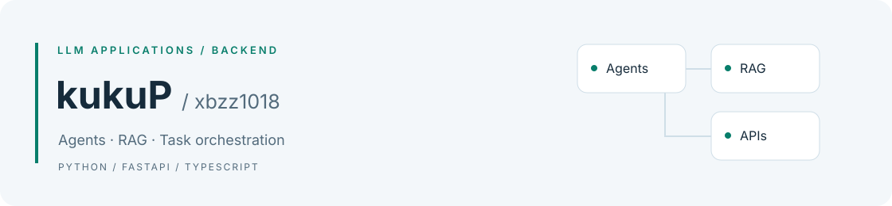
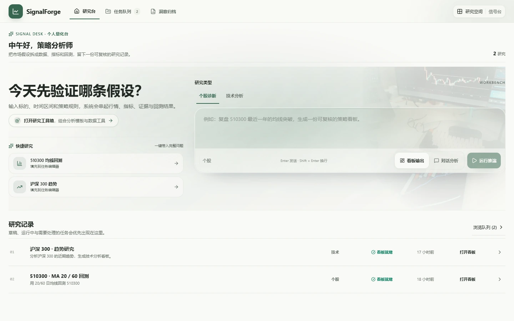
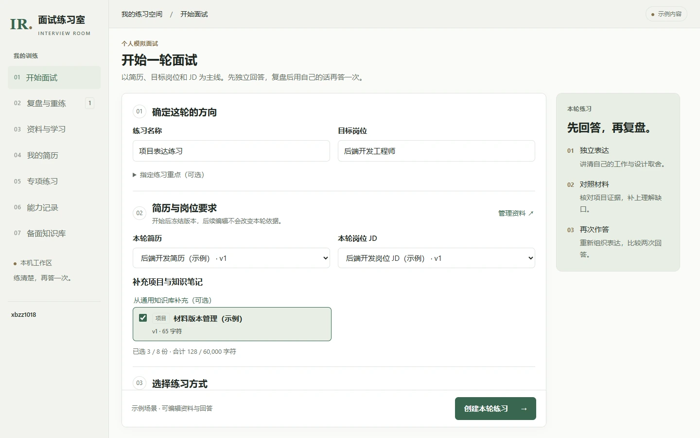
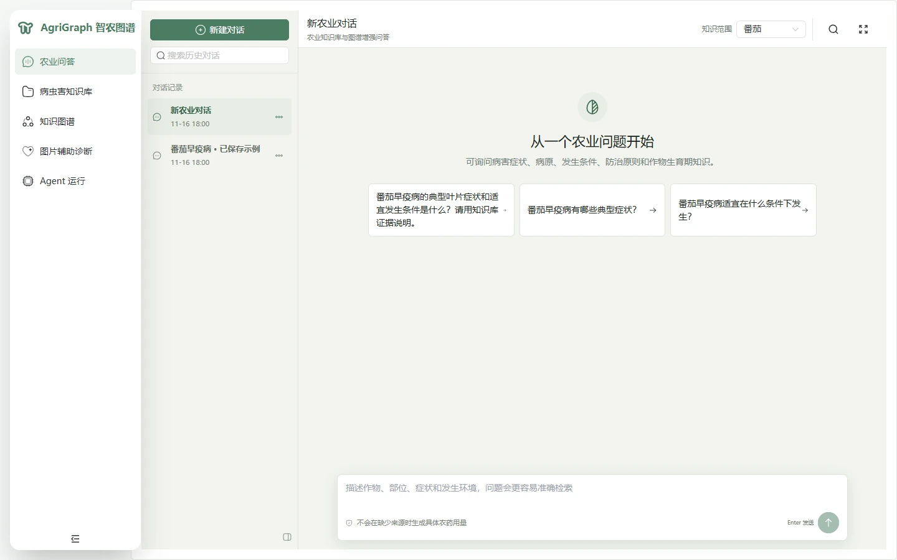
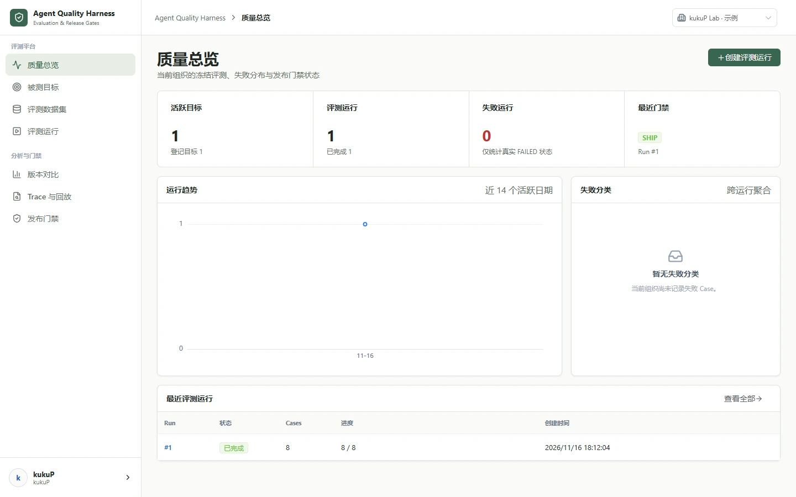

<picture>
  <source media="(max-width: 600px) and (prefers-color-scheme: dark)" srcset="assets/banner-compact-dark.svg">
  <source media="(max-width: 600px)" srcset="assets/banner-compact.svg">
  <source media="(prefers-color-scheme: dark)" srcset="assets/banner-dark.svg">
  <source media="(prefers-color-scheme: light)" srcset="assets/banner.svg">
  
</picture>

我做 Agent 应用和后端服务，关注工具调用、检索和任务编排。

[个人网站与交互演示](https://kukup.xbzz.cloud/) · [开源贡献](#开源贡献) · [English](README.en.md)

## 精选项目

<table>
  <tr>
    <td width="50%" valign="top">
      <h3>SignalForge</h3>
      <a href="https://kukup.xbzz.cloud/projects/signalforge">
        <picture>
          <source media="(prefers-color-scheme: dark)" srcset="assets/projects/signal-home-dark.webp">
          
        </picture>
      </a>
      
从研究问题出发，查行情、回测策略，生成可复查的交互看板。

      
<a href="https://kukup.xbzz.cloud/projects/signalforge">体验演示</a> · <a href="https://github.com/xbzz1018/SignalForge-Python">查看源码</a>

    </td>
    <td width="50%" valign="top">
      <h3>面试练习室</h3>
      <a href="https://kukup.xbzz.cloud/projects/interview-room">
        <picture>
          <source media="(prefers-color-scheme: dark)" srcset="assets/projects/interview-home-dark.webp">
          
        </picture>
      </a>
      
按岗位和项目材料做文字面试，逐题看参考、重答与复盘。

      
<a href="https://kukup.xbzz.cloud/projects/interview-room">体验演示</a> · <a href="https://github.com/xbzz1018/interview-room">查看源码</a>

    </td>
  </tr>
  <tr>
    <td width="50%" valign="top">
      <h3>AgriGraph</h3>
      <a href="https://kukup.xbzz.cloud/projects/agrigraph">
        <picture>
          <source media="(prefers-color-scheme: dark)" srcset="assets/projects/agrigraph-home-dark.webp">
          
        </picture>
      </a>
      
查作物病害，沿引用回看资料，再用图谱查看症状与发生条件。

      
<a href="https://kukup.xbzz.cloud/projects/agrigraph">体验演示</a> · <a href="https://github.com/xbzz1018/agrigraph">查看源码</a>

    </td>
    <td width="50%" valign="top">
      <h3>Agent Quality Harness</h3>
      <a href="https://kukup.xbzz.cloud/projects/quality-harness">
        <picture>
          <source media="(prefers-color-scheme: dark)" srcset="assets/projects/quality-home-dark.webp">
          
        </picture>
      </a>
      
用同一份数据集比较两个 Agent 版本，回看失败样例，检查发布门禁。

      
<a href="https://kukup.xbzz.cloud/projects/quality-harness">体验演示</a> · <a href="https://github.com/xbzz1018/agent-quality-gate">查看源码</a>

    </td>
  </tr>
</table>

更多项目 · [SignalForge Java](https://github.com/xbzz1018/SignalForge-Java) · [WorkPilot](https://github.com/xbzz1018/workpilot) · [LearningLoop](https://github.com/xbzz1018/learningloop) · [全部公开仓库](https://github.com/xbzz1018?tab=repositories&type=source)

## 开源贡献

| 项目 | 参与内容 |
| --- | --- |
| [DeerFlow](https://github.com/bytedance/deer-flow) | 模型调用参数适配与工具产物处理。 [#6898](https://github.com/bytedance/deer-flow/pull/6898) 保留 Codex `tool_choice` · [#6574](https://github.com/bytedance/deer-flow/pull/6574) 保留完整产物 URL（已合并） |
| [Cindy](https://github.com/makecindy/cindy) | 为超出首屏的命令匹配结果增加「显示更多」。 [#4866](https://github.com/makecindy/cindy/pull/4866)（待合并） |

[完整贡献记录](docs/open-source.md) · [查看公开 PR](https://github.com/search?q=author%3Axbzz1018+is%3Apr+is%3Apublic+-user%3Axbzz1018&amp;type=pullrequests)
